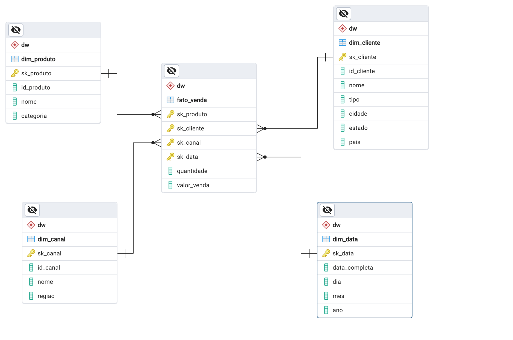
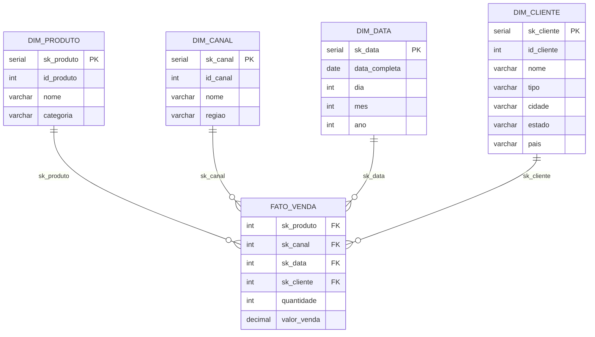
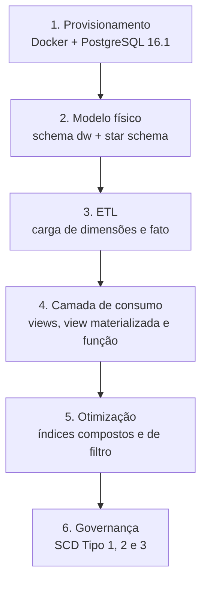
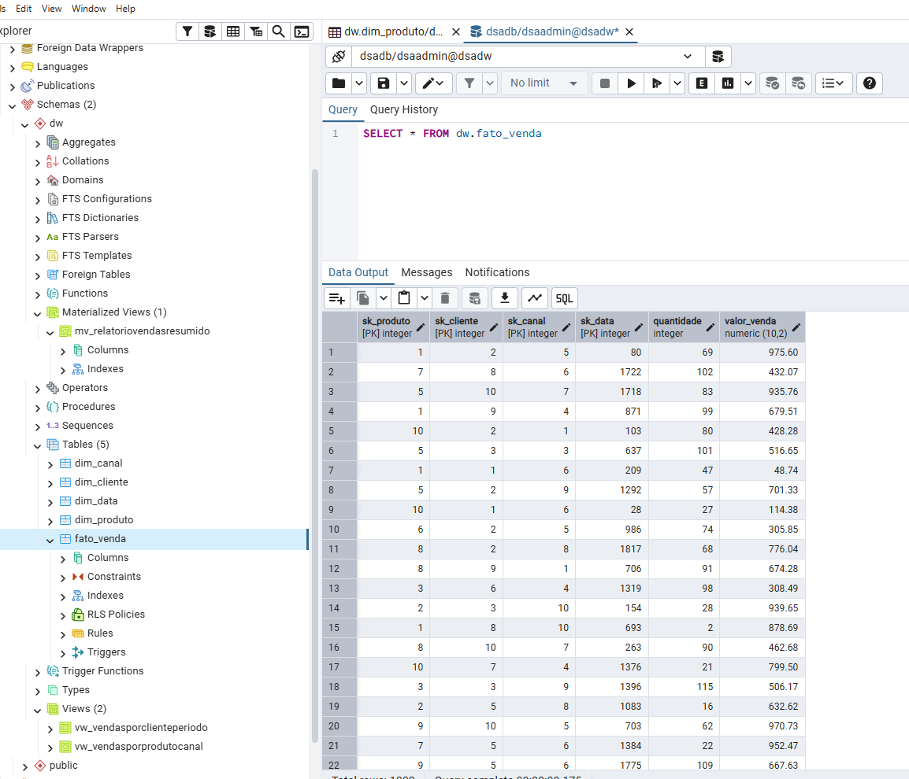
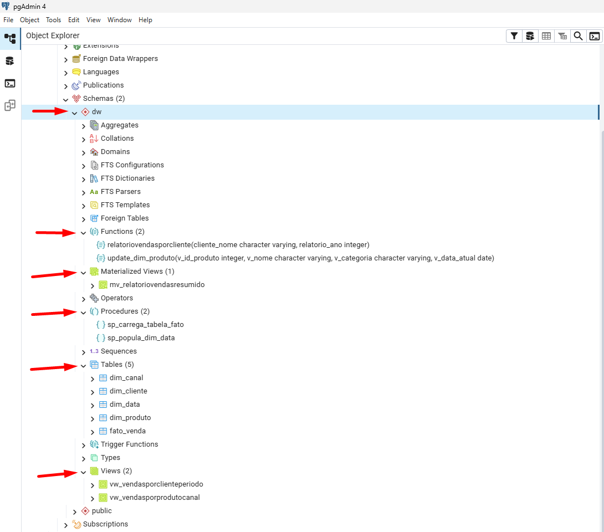
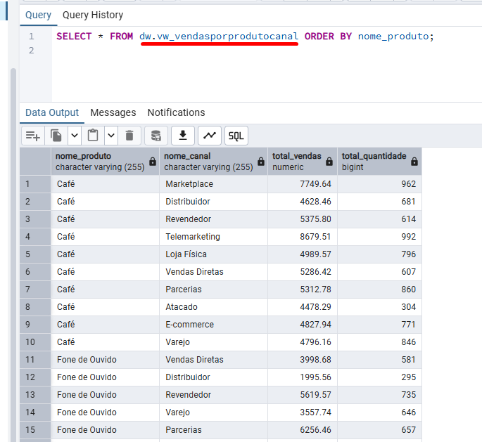
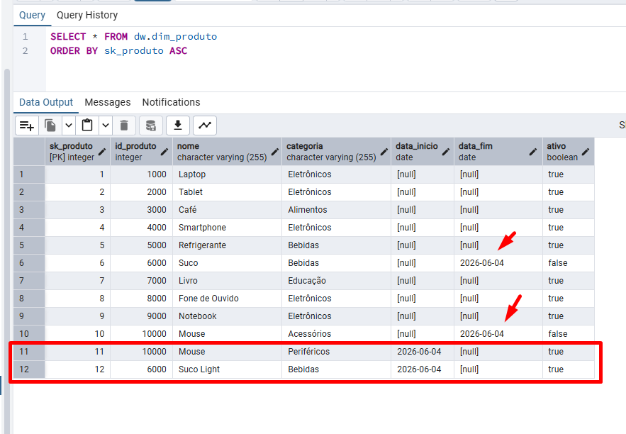
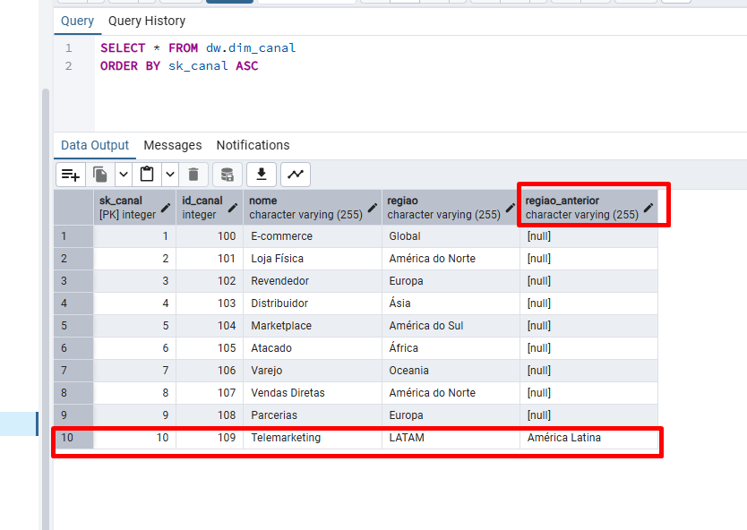

# Data Warehouse de Vendas — PostgreSQL + Docker


Data Warehouse dimensional de vendas construído em ambiente local com Docker e PostgreSQL, cobrindo o ciclo completo de um DW: modelagem em esquema estrela, ETL, camada de consumo analítica, otimização por índices e gestão de histórico com *Slowly Changing Dimensions* (Tipo 1, 2 e 3).



> Projeto desenvolvido no módulo **"Modelagem, Implementação e Governança de Data Warehouses"** de uma pós-graduação em Engenharia de Dados.

## Sumário

- [Sobre o projeto](#sobre-o-projeto)
- [Arquitetura da solução](#arquitetura-da-solução)
- [Fluxo de dados](#fluxo-de-dados)
- [Modelo dimensional](#modelo-dimensional)
- [Tecnologias](#tecnologias)
- [Estrutura do repositório](#estrutura-do-repositório)
- [Como executar](#como-executar)
- [Relatórios e consultas](#relatórios-e-consultas)
- [Slowly Changing Dimensions](#slowly-changing-dimensions)
- [Aprendizados](#aprendizados)
- [Desafios enfrentados](#desafios-enfrentados)
- [Melhorias futuras](#melhorias-futuras)
- [Licença](#licença)
- [Autor](#autor)

## Sobre o projeto

O objetivo é demonstrar, na prática, como projetar e operar um Data Warehouse dimensional voltado à análise de vendas. A partir de um modelo lógico fornecido (ver [`docs/enunciado.md`](docs/enunciado.md)), o projeto implementa o modelo físico no PostgreSQL, carrega dados fictícios que simulam um cenário corporativo multicategoria e multirregião, e entrega uma camada analítica pronta para consumo.

O **problema de negócio simulado** é a necessidade de responder perguntas analíticas — vendas por produto e canal, por cliente ao longo do tempo, por categoria e por ano — a partir de dados organizados de forma otimizada para leitura, separando claramente as entidades de análise (dimensões) do evento mensurável (a venda).

## Arquitetura da solução

A solução vive inteiramente no schema `dw` e segue um **esquema estrela (star schema)**: uma tabela fato central (`fato_venda`) cercada por quatro dimensões, cada uma conectada à fato por uma chave estrangeira.



Um destaque de modelagem: embora o modelo lógico original definisse as chaves naturais diretamente na fato, a implementação adota **surrogate keys** (`sk_*`, do tipo `SERIAL`) como chave primária de cada dimensão, mantendo a chave natural (`id_*`) como atributo. A `fato_venda` referencia apenas as `sk_*`. Isso desacopla o DW das chaves de origem e é pré-requisito técnico para o SCD Tipo 2.

## Fluxo de dados

A ordem de execução dos scripts reflete as etapas do pipeline:



No ETL, as dimensões `produto`, `canal` e `cliente` são carregadas por `INSERT` direto. A `dim_data` é populada por uma *stored procedure* que percorre um laço de datas (2021 a 2031), gerando uma linha por dia. A `fato_venda` é carregada por outra procedure que gera 1.000 vendas, sorteando surrogate keys válidas de cada dimensão e tratando colisões de chave primária com `EXCEPTION WHEN unique_violation`.

Uma amostra da `fato_venda` após a carga, com as 1.000 vendas geradas:



## Modelo dimensional

| Tabela | Tipo | Chave primária | Principais atributos |
|---|---|---|---|
| `dim_produto` | Dimensão | `sk_produto` | `id_produto`, `nome`, `categoria` |
| `dim_canal` | Dimensão | `sk_canal` | `id_canal`, `nome`, `regiao` |
| `dim_data` | Dimensão | `sk_data` | `data_completa`, `dia`, `mes`, `ano` |
| `dim_cliente` | Dimensão | `sk_cliente` | `id_cliente`, `nome`, `tipo`, `cidade`, `estado`, `pais` |
| `fato_venda` | Fato | `sk_produto + sk_canal + sk_data + sk_cliente` | `quantidade`, `valor_venda` |

As métricas da fato (`quantidade` e `valor_venda`) são aditivas, podendo ser somadas em qualquer recorte dimensional.

Estrutura criada no schema `dw`, vista no pgAdmin:



## Tecnologias

- **PostgreSQL 16.1** — SGBD do Data Warehouse
- **Docker / Docker Compose** — containerização e provisionamento do ambiente
- **PL/pgSQL** — *stored procedures* e *functions* para ETL e relatórios
- **pgAdmin** — administração, execução de scripts e modelagem visual (`docs/Projeto1.pgerd`)

## Estrutura do repositório

```
postgres-sales-data-warehouse/
├── README.md
├── LICENSE
├── .gitignore
├── .env.example
├── docker-compose.yml
├── docs/
│   ├── enunciado.md          # Enunciado original do projeto
│   └── Projeto1.pgerd        # Diagrama do modelo (pgAdmin)
├── scripts/
│   └── run_all.sh            # Executa todos os SQLs na ordem
└── sql/
    ├── 01_modelo_fisico.sql  # Schema dw + tabelas (DDL)
    ├── 02_etl.sql            # Carga de dimensões e fato
    ├── 03_relatorios.sql     # Views, view materializada e função
    ├── 04_indices.sql        # Índices de otimização
    ├── 05_scd_tipo_1.sql     # SCD Tipo 1 (sobrescrita)
    ├── 06_scd_tipo_2.sql     # SCD Tipo 2 (histórico completo)
    └── 07_scd_tipo_3.sql     # SCD Tipo 3 (valor atual + anterior)
```

## Como executar

### Pré-requisitos

- [Docker](https://www.docker.com/) e Docker Compose
- Opcional: [pgAdmin](https://www.pgadmin.org/) ou `psql` para executar os scripts

### Passo a passo

1. **Clone o repositório:**

   ```bash
   git clone https://github.com/JonathanSanno/postgres-sales-data-warehouse.git
   cd postgres-sales-data-warehouse
   ```

2. **Configure as variáveis de ambiente:**

   ```bash
   cp .env.example .env
   ```

   Ajuste os valores em `.env` se desejar (o arquivo não é versionado).

3. **Suba o container PostgreSQL:**

   ```bash
   docker compose up -d
   ```

   O banco ficará disponível em `localhost:5431` (porta configurável via `.env`).

4. **Execute os scripts SQL na ordem.** Você pode fazer isso de três formas:

   **Opção A — via script de conveniência:**

   ```bash
   bash scripts/run_all.sh
   ```

   **Opção B — manualmente com `psql`:**

   ```bash
   docker exec -i dsadw psql -U dsaadmin -d dsadb < sql/01_modelo_fisico.sql
   # repita para os demais arquivos, na ordem 01 → 07
   ```

   **Opção C — via pgAdmin:** conecte-se ao servidor (host `localhost`, porta `5431`, usuário e senha do `.env`) e execute cada script na ordem numérica.

> Para reiniciar o ambiente do zero (removendo os dados): `docker compose down -v && docker compose up -d`.

## Relatórios e consultas

O script `03_relatorios.sql` entrega a camada analítica em quatro formatos complementares:

- **`vw_vendasporprodutocanal`** — view com total de vendas e quantidade por produto e canal.
- **`vw_vendasporclienteperiodo`** — view com vendas por cliente, ano e mês.
- **`mv_relatoriovendasresumido`** — view materializada com vendas por categoria e ano (atualizável via `REFRESH MATERIALIZED VIEW`).
- **`relatoriovendasporcliente(cliente_nome, ano)`** — função parametrizada que retorna uma tabela, com filtros opcionais por cliente e/ou ano.

**Exemplo de execução** — saída do relatório de vendas por produto e canal, no pgAdmin:



## Slowly Changing Dimensions

O projeto demonstra as três abordagens clássicas de gestão de mudança histórica em dimensões:

| Tipo | Estratégia | Dimensão | Comportamento |
|---|---|---|---|
| **Tipo 1** | Sobrescrita | `dim_cliente` | Atualiza o registro no lugar, sem preservar histórico. |
| **Tipo 2** | Histórico completo | `dim_produto` | Fecha o registro vigente (`data_fim`, `ativo = false`) e insere uma nova versão. |
| **Tipo 3** | Valor atual + anterior | `dim_canal` | Mantém uma coluna `regiao_anterior` ao lado do valor corrente. |

### Exemplo: SCD Tipo 2 em ação

Após executar a função `update_dim_produto`, o produto alterado passa a ter dois registros na `dim_produto`: o antigo, com `data_fim` preenchida e `ativo = false`, e o novo, ativo. Na prática, o resultado fica assim:



### Exemplo: SCD Tipo 3

No Tipo 3, a `dim_canal` guarda o valor atual e o anterior na mesma linha. Depois da mudança do canal `109`, a coluna `regiao` mostra `LATAM` e `regiao_anterior` mostra `América Latina`:



## Aprendizados

> **Personalize esta seção** com a sua experiência real durante o desenvolvimento. Abaixo, os pontos técnicos efetivamente trabalhados no projeto, que servem de base.

- Implementação de um **esquema estrela** completo, da modelagem física à carga.
- Diferença prática entre **surrogate keys** e chaves naturais, e por que desacoplar o DW das fontes.
- Construção de uma **dimensão de data** pré-populada via *stored procedure*.
- Definição de **granularidade** e identificação de **métricas aditivas** na tabela fato.
- Criação de uma camada de consumo com **views, view materializada e funções** em PL/pgSQL.
- Uso de **índices** orientados aos padrões de consulta dos relatórios.
- Implementação das três estratégias de **Slowly Changing Dimensions**.
- Provisionamento de um ambiente de banco **reprodutível com Docker**.

## Desafios enfrentados

> **Personalize esta seção** com os obstáculos reais que você encontrou. Abaixo, desafios técnicos evidenciados pelo próprio projeto.

- Garantir a unicidade dos registros na fato durante a carga aleatória, tratando colisões de chave primária com `EXCEPTION WHEN unique_violation`.
- Gerar proceduralmente uma dimensão de data abrangendo múltiplos anos.
- Aplicar corretamente cada tipo de SCD, entendendo quando preservar histórico e quando sobrescrever.

## Melhorias futuras

Itens mapeados para evoluir o projeto pensando em um padrão de produção:

- **Repensar o grão da fato:** substituir a chave primária composta por uma surrogate key própria (`sk_venda`), permitindo múltiplas vendas com a mesma combinação de dimensões.
- **Smart key na `dim_data`:** adotar uma chave no formato `YYYYMMDD`, mais legível e eficiente para filtros por intervalo.
- **Dados sintéticos realistas:** gerar `valor_venda` proporcional ao produto e à quantidade, tornando os relatórios mais críveis.
- **Idempotência dos scripts:** adicionar `IF NOT EXISTS` / `DROP ... IF EXISTS` para permitir reexecução sem erros.
- **Padronização:** unificar nomenclatura em `snake_case` e tratamento consistente de valores nulos.
- **Membro "desconhecido" nas dimensões:** incluir uma linha sentinela (`sk = -1`) para preservar fatos sem dimensão correspondente.

## Licença

Distribuído sob a licença MIT. Veja o arquivo [`LICENSE`](LICENSE) para mais detalhes.

## Autor

**Jonathan Sanno Mury Bonfim**

- LinkedIn: [linkedin.com/in/jonathan-bonfim](https://www.linkedin.com/in/jonathan-bonfim)
- GitHub: [github.com/JonathanSanno](https://github.com/JonathanSanno)

---

Se este projeto te ajudou ou te interessou, deixe uma estrela no repositório.
